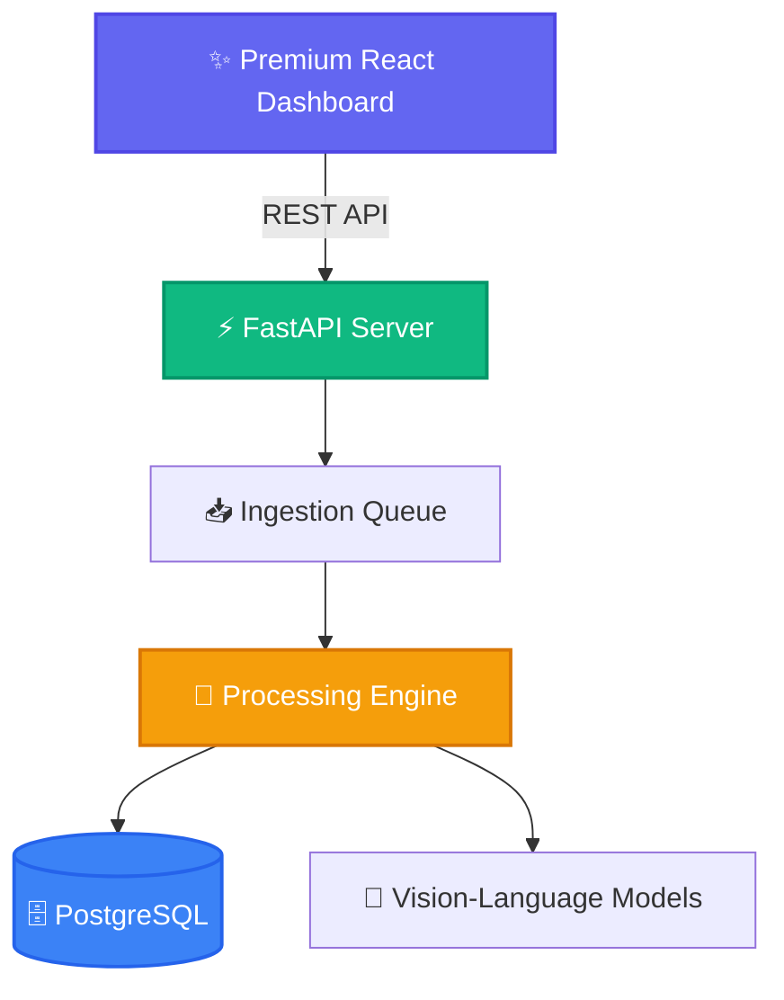

<div align="center">
  <h1>✨ UniSensoryAI ✨</h1>
  <p><b>A unified, modular AI agent system for multi-modal document perception and understanding.</b></p>

  <p>
    <a href="https://github.com/yourusername/UniSensoryAI/blob/main/LICENSE">
      
    </a>
    <a href="https://www.python.org/downloads/">
      
    </a>
    <a href="https://react.dev/">
      
    </a>
  </p>
</div>

---

## 🌟 Overview

UniSensoryAI seamlessly processes diverse document formats (PDF, Excel, Word, PowerPoint, Images) by harnessing the power of advanced Vision-Language Models (VLMs). Designed with a clean, extensible, abstraction-first architecture, it provides an async backend with robust job queuing and a beautiful, high-performance React dashboard.

> [!NOTE]
> UniSensoryAI enables you to effortlessly ingest, track, and inspect documents while seamlessly switching between local models and cloud providers.

### ✨ Key Features

- 🧠 **Model Agnostic**: Swap seamlessly between local models (Qwen, DeepSeek, LLaVA, LightOn) and cloud APIs (OpenAI, Google).
- 🧩 **Abstraction-First Design**: Built with clean interfaces, ensuring every component is pluggable and maximally flexible.
- ⚙️ **Configuration-Driven**: Define behavior elegantly through YAML configs—no hardcoded values.
- 🚀 **Async Pipeline**: Background job processing with built-in rate limiting, intelligent model caching, and robust error handling.
- 💎 **Premium Dashboard**: A sleek, dynamic React interface to upload documents, track jobs, and interactively test models.
- 🗄️ **Persistent State**: Powered by Async SQLAlchemy 2.0 and PostgreSQL for rock-solid reliability.

---

## 🚀 Quick Start

### Prerequisites

- **Python** 3.10 - 3.11
- **PostgreSQL** 17
- **Node.js** 18+

### 🛠️ Backend Setup

```bash
# Clone the repository
git clone <repo-url>
cd UniSensoryAI

# Install dependencies (development mode recommended)
pip install -e ".[dev]"

# Set up PostgreSQL database
createdb unisensory
alembic upgrade head

# Launch the API server
python -m src.api.server
```
*(The API will be available at port 8010)*

### 💻 Frontend Setup

```bash
cd frontend
npm install
npm run dev
```
*(Access the dynamic dashboard at `http://localhost:5173`)*

---

## 📡 API Reference

Explore our robust, RESTful endpoints tailored for seamless integration.

The [reusable extraction guide](documentation/EXTRACTION_API.md) covers Python embedding,
text-only and multimodal PDF modes, external business schemas, and injectable model providers.

| Method | Endpoint | Description |
| :--- | :--- | :--- |
| `GET` | `/health` | System health check |
| `POST` | `/v1/process_document` | Upload document for async processing (returns `job_id`) |
| `POST` | `/v1/extract` | Return text-only or multimodal PDF content, optionally with external-schema fields |
| `POST` | `/v1/extract/fields` | Apply an external schema to an existing document result |
| `GET` | `/v1/jobs` | List jobs with pagination (`?limit=50&offset=0`) |
| `GET` | `/v1/jobs/{job_id}` | Fetch job status and resulting artifacts |
| `DELETE` | `/v1/jobs/{job_id}` | Erase a job and associated files |
| `POST` | `/v1/jobs/{job_id}/retry` | Instantly retry a failed processing job |

---

## ⚙️ Configuration

UniSensoryAI strictly follows a configuration-over-code philosophy. 

### Adding a New Model (`configs/models.yaml`)

```yaml
models:
  my-custom-model:
    provider: huggingface # Options: deepseek, openai, google, qwen, llava, etc.
    model_id: my-custom-model
    model_name: "org/model-name"
    model_type: vision-language
    config:
      dtype: bfloat16
      device_map: auto
```

### Implementing the Model

```python
from src.utils import ConfigLoader
from src.models import ModelLoader

config = ConfigLoader.get_model_config("my-custom-model")
model = ModelLoader.load_model(config)
result = model.process(image=image_bytes, prompt="Describe this image dynamically")
```

---

## 🏗️ Project Architecture



---

## 🛠️ Development

Maintain highest code quality standards with our pre-configured toolkit:

```bash
black src/ tests/        # Formatting
isort src/ tests/        # Import sorting
ruff check src/ tests/   # Fast linting
mypy src/                # Strict type checking

# Testing
pytest tests/ -v         # Run test suite
```

---

## 📜 License

Released under the [MIT License](LICENSE). Build something extraordinary! ✨
