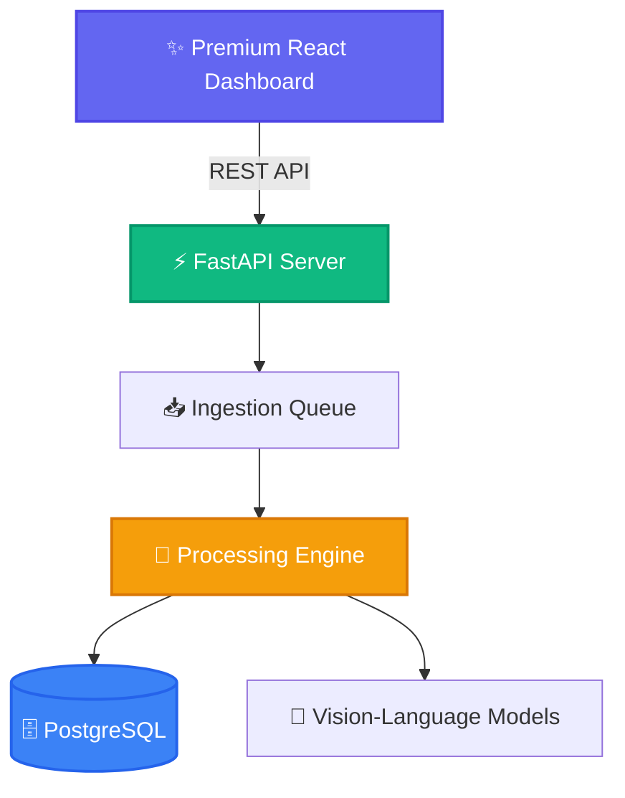

<div align="center">
  <h1>✨ UniSensoryAI ✨</h1>
  <p><b>A unified, modular AI agent system for multi-modal document perception and understanding.</b></p>

  <p>
    <a href="https://github.com/yourusername/UniSensoryAI/blob/main/LICENSE">
      
    </a>
    <a href="https://www.python.org/downloads/">
      
    </a>
    <a href="https://react.dev/">
      
    </a>
  </p>
</div>

---

## 🌟 Overview

UniSensoryAI seamlessly processes diverse document formats (PDF, Excel, Word, PowerPoint, Images) by harnessing the power of advanced Vision-Language Models (VLMs). Designed with a clean, extensible, abstraction-first architecture, it provides an async backend with robust job queuing and a beautiful, high-performance React dashboard.

> [!NOTE]
> UniSensoryAI enables you to effortlessly ingest, track, and inspect documents while seamlessly switching between local models and cloud providers.

### ✨ Key Features

- 🧠 **Model Agnostic**: Swap seamlessly between local models (Qwen, DeepSeek, LLaVA, LightOn) and cloud APIs (OpenAI, Google).
- 🧩 **Abstraction-First Design**: Built with clean interfaces, ensuring every component is pluggable and maximally flexible.
- ⚙️ **Configuration-Driven**: Define behavior elegantly through YAML configs—no hardcoded values.
- 🚀 **Async Pipeline**: Background job processing with built-in rate limiting, intelligent model caching, and robust error handling.
- 💎 **Premium Dashboard**: A sleek, dynamic React interface to upload documents, track jobs, and interactively test models.
- 🗄️ **Persistent State**: Powered by Async SQLAlchemy 2.0 and PostgreSQL for rock-solid reliability.
- 📄 **PAPER Review**: Upload scanned or digital PDFs, inspect retained text/evidence/warnings, and prepare editable agreement or invoice drafts with separate approval steps and persisted extraction history.

---

## 🚀 Quick Start

### Run everything with Docker

From this repository directory, keep your existing `.env` and `frontend/.env`,
stop any manually started API/web servers using ports 8010/5173, then run:

```bash
docker compose up --build
```

Open the [web app](http://localhost:5173), [PAPER workspace](http://localhost:5173/paper),
or [API docs](http://localhost:8010/docs). Compose starts PostgreSQL, Redis, the
single-process API, and the Vite development server. Database migrations run
before API startup. Source/configuration changes are mounted from this checkout;
restart the API after Python changes. Vite refreshes frontend changes automatically.

Existing `postgres_data` and `redis_data` volumes are reused under the same Compose
project name. Local `data/` is mounted into the API, including existing uploads;
stored upload paths work across Windows/manual and Linux/container startup.
The backend reads `.env`, the frontend reads its existing Vite env files, and
`configs/` stays mounted. Only database/Redis connection hosts and the server-side
Vite proxy change to Docker service names. OAuth callbacks default to the public
`http://localhost:8010`; an explicit `OAUTH_REDIRECT_BASE_URL` is retained.
Keep using the same browser origin
(for example `http://localhost:5173`) to retain browser settings and session cookies.

PostgreSQL remains available to manual tools at `localhost:5434`. Redis is internal
at `redis:6379`, so another application's host Redis on port 6379 can keep running.
Docker selects the Redis queue by default; an explicit `QUEUE_BACKEND` override
is retained. Background worker coroutines run inside the API process, with
`WORKER_CONCURRENCY=4` by default, rather than in a separate worker container.
They dispatch PAPER extraction and existing document workflows through separate
handlers. PostgreSQL stores upload status/history; `data/` retains originals and
extraction result artifacts. The PAPER upload/history addition needs no new
database migration. If manually running the API with `QUEUE_BACKEND=redis`,
explicitly publish Redis on a free host port and set the corresponding host
`REDIS_URL` for that manual process. Manual startup otherwise defaults to the
in-memory queue.

Use `docker compose stop` to stop the stack or `docker compose down` to remove
containers while retaining named volumes and local files. **Do not use
`docker compose down -v` when keeping database data.** Keep the same checkout/project
name when restarting; a different Compose project uses different named volumes.

The default image supports cloud models and the PAPER workflows. For local
Hugging Face models, enable the larger NVIDIA image/device overlay:

```bash
docker compose -f docker-compose.yml -f docker-compose.gpu.yml up --build
```

This requires GPU support in Docker Desktop and enough GPU memory for the selected
model. `HF_CACHE_DIR` can point to an existing Hugging Face cache; otherwise model
downloads persist in `./models_cache/huggingface`. Model-specific optional packages
(such as FlashAttention for configurations selecting it) have the same requirements
as manual startup. The production overlay is documented in [deploy/README.md](deploy/README.md).

### Prerequisites

- **Python** 3.10 - 3.11
- **PostgreSQL** 17
- **Node.js** 18+

### 🛠️ Optional manual backend setup

Use this instead of Docker, with your own database and model environment. For
scanned PDF OCR and schema fields, set `EXTRACTION_CONFIG_PATH=configs/extraction.yaml`
and the extraction environment variables described below before starting the API.

```bash
# Clone the repository
git clone <repo-url>
cd UniSensoryAI

# Install dependencies (development mode recommended)
pip install -e ".[dev]"

# Set up PostgreSQL database
createdb unisensory
alembic upgrade head

# Launch the API server
python -m src.api.server
```
*(The API will be available at port 8010)*

### 💻 Optional manual frontend setup

```bash
cd frontend
npm install
npm run dev
```
*(Access the dynamic dashboard at `http://localhost:5173`)*

---

## 📡 API Reference

Explore our robust, RESTful endpoints tailored for seamless integration.

The [reusable extraction guide](documentation/EXTRACTION_API.md) covers Python embedding,
text-only and multimodal PDF modes, external business schemas, and injectable model providers.

The [PAPER UI testing guide](documentation/PAPER_UI_TESTING.md) covers the web app's `/paper`
PDF upload, background extraction, persisted history, and editable agreement/invoice
drafts, plus the existing manual forms and JSON testing for versioned agreements,
reconciliation, corrections, duplicates, and AP decisions.

In **PAPER review**, upload a PDF as a rent agreement or invoice, inspect the original,
full text, JSON, evidence, and warnings, then select **Review / edit agreement** or
**Review / edit invoice** to open a local editable copy. If an unsaved draft is already
open, explicitly choose to replace it or keep the current work. Saving and approval
remain separate. Extracted history is immutable
while the review copy is edited; unsaved form edits do not survive reload until saved as
an agreement draft or invoice case. **Upload history** and **Documents** in the sidebar
restore tenant-scoped server history across sessions. A completed extraction can still
be partial and need manual review; processing completion does not imply approval.

| Method | Endpoint | Description |
| :--- | :--- | :--- |
| `GET` | `/health` | System health check |
| `POST` | `/v1/process_document` | Upload document for async processing (returns `job_id`) |
| `POST` | `/v1/extract` | Stateless text-only or multimodal PDF extraction, optionally with external-schema fields; no saved job/history |
| `POST` | `/v1/extract/fields` | Apply an external schema to an existing document result without storing a job |
| `POST` | `/v1/paper/extractions` | Queue a PDF for OCR and agreement/invoice schema fields; return a persisted job with HTTP 202 |
| `GET` | `/v1/paper/extractions` | List tenant extraction history with pending, processing, completed, and failed attempts |
| `GET` | `/v1/paper/extractions/{job_id}` | Reopen saved document content, canonical fields, evidence, and warnings |
| `GET` | `/v1/paper/extractions/{job_id}/file` | Open the tenant-authorized original PDF |
| `POST` | `/v1/paper/extractions/{job_id}/retry` | Queue a new attempt for a failed extraction while retaining its prior history |
| `GET` | `/v1/jobs` | List jobs with pagination (`?limit=50&offset=0`) |
| `GET` | `/v1/jobs/{job_id}` | Fetch job status and resulting artifacts |
| `DELETE` | `/v1/jobs/{job_id}` | Erase a job and associated files |
| `POST` | `/v1/jobs/{job_id}/retry` | Instantly retry a failed processing job |

---

## ⚙️ Configuration

UniSensoryAI strictly follows a configuration-over-code philosophy. 

### PDF OCR and external-schema extraction

Docker selects `configs/extraction.yaml` through `EXTRACTION_CONFIG_PATH`. Its
deployment-owned `vision` and `fields` profiles read `EXTRACTION_BASE_URL`,
`EXTRACTION_MODEL`, and `EXTRACTION_API_KEY`; Compose can fall back to the existing
`OPENAI_API_BASE` / `OPENAI_API_KEY` environment values. The base URL ends at the API
version prefix, such as `/v1` or `/openai/v1`, and the OCR model must support images.
Keep credentials in the deployment environment. Recreate the API container after
environment changes.

Queued PDF extraction uses `EXTRACTION_WORKFLOW_TIMEOUT_SECONDS=1800` by default
(maximum 3600) to allow OCR across long agreements. Individual model calls retain
the configured 60-second limit; library-only extraction keeps its 300-second default.

Use `configs/extraction.example.yaml` for separate vision and field models/endpoints,
or inject alternative generation providers into the reusable extraction service for
other protocols. Models, credentials, and provider-specific settings stay outside PAPER
schemas and UI code. Library-only callers without configured profiles retain native-only
extraction; scans and business fields require appropriate model profiles. See the
[configuration and embedding guide](documentation/EXTRACTION_API.md).

### Adding a New Model (`configs/models.yaml`)

```yaml
models:
  my-custom-model:
    provider: huggingface # Options: deepseek, openai, google, qwen, llava, etc.
    model_id: my-custom-model
    model_name: "org/model-name"
    model_type: vision-language
    config:
      dtype: bfloat16
      device_map: auto
```

### Implementing the Model

```python
from src.utils import ConfigLoader
from src.models import ModelLoader

config = ConfigLoader.get_model_config("my-custom-model")
model = ModelLoader.load_model(config)
result = model.process(image=image_bytes, prompt="Describe this image dynamically")
```

---

## 🏗️ Project Architecture



---

## 🛠️ Development

Maintain highest code quality standards with our pre-configured toolkit:

```bash
black src/ tests/        # Formatting
isort src/ tests/        # Import sorting
ruff check src/ tests/   # Fast linting
mypy src/                # Strict type checking

# Testing
pytest tests/ -v         # Run test suite
```

---

## 📜 License

Released under the [MIT License](LICENSE). Build something extraordinary! ✨
