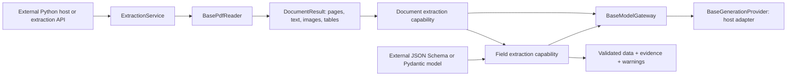

# Reusable PDF extraction

The implemented boundary lives in `src/extraction/`. It exposes three independent async operations: `extract_document`, `extract_fields`, and `extract` (both together). Applications can embed this package without starting FastAPI, the database, the ingestion queue, or local ML models.

The existing basic/advanced pipelines, upload job API, chat, and policy workflows retain their behavior. Two additive endpoints expose the new service; switching existing job processing to this service is a separate migration. The general workflow registry described in `WORKFLOW_ABSTRACTION.md` remains a future design. This implementation uses a small composition facade and replaceable capabilities instead.



## Extraction choices

| Option | Result | Model requirement |
| --- | --- | --- |
| `content_mode="text", text_strategy="native_only"` | All selected native text blocks, with page IDs and coordinates | None |
| `content_mode="text", text_strategy="native_then_ocr"` | Native text plus OCR from scans and embedded image regions; output excludes images/tables | Vision profile when OCR is needed |
| `content_mode="multimodal", text_strategy="native_only"` | Native text, native tables, image regions, and a rendered preview of every selected page | None |
| `content_mode="multimodal", text_strategy="native_then_ocr"` | The above plus scan OCR and descriptions of embedded images | Vision profile when inference is needed |
| `extract_fields(document, schema)` | Caller-defined nested objects, key-value fields and line items, with separate source evidence | Fields profile; images also supplied if supported |

Output mode and OCR strategy are independent. A short digital value such as `PO-123` remains native text. Pages retain their original one-based PDF numbers, including page-range selections and blank pages. Coordinates use displayed PDF points, matching page dimensions and rendered assets, including rotated PDFs. Images are self-contained base64 PNGs, bounded by `max_asset_bytes`; no temporary asset paths need to survive the request.

Multimodal output preserves page appearance and exposes native structures. Descriptions and extracted values depend on the chosen model. Native table detection is best-effort; unavailable detection produces a warning. Image-derived key-value fields need OCR/description text to verify literal evidence; use `native_then_ocr` for scans. Full-page previews give image-capable field models layout context; text-only field models use extracted text. This does not promise perfect OCR, chart interpretation, or reconciliation decisions.

## Embed in Python

```python
from pathlib import Path
from pydantic import BaseModel
from src.extraction import ExtractionOptions, PdfSource, build_extraction_service

class InvoiceRequirement(BaseModel):
    invoice_number: str
    total: str

async def process_invoice():
    service = await build_extraction_service(config_path=Path("configs/extraction.yaml"))
    try:
        document = await service.extract_document(
            PdfSource(path=Path("invoice.pdf")),
            ExtractionOptions(content_mode="multimodal", text_strategy="native_then_ocr"),
        )
        fields = await service.extract_fields(document, InvoiceRequirement)
        return fields.data, fields.evidence, fields.warnings
    finally:
        await service.aclose()
```

Caller Pydantic validators run after JSON Schema validation. Passing a Pydantic class preserves those Python business rules; exporting its schema and sending it over HTTP preserves only portable JSON Schema constraints. The core imports no invoice-specific model. An example external contract is in `examples/schemas/invoice_reconciliation.json`.

`examples/extract_pdf.py` is an executable entry point:

```powershell
python -m examples.extract_pdf invoice.pdf
python -m examples.extract_pdf invoice.pdf --mode multimodal
python -m examples.extract_pdf invoice.pdf --mode multimodal --ocr --config configs/extraction.yaml --schema examples/schemas/invoice_reconciliation.json
```

## Configure or replace a model

The packaged defaults register no providers. Native-only extraction works immediately. Copy `configs/extraction.example.yaml` to a deployment configuration, bind `vision` and `fields` to your endpoint/model, and set the credential environment variable. API deployments select it with `EXTRACTION_CONFIG_PATH`. Request payloads select logical profile names and do not contain endpoint credentials.

The HTTP adapter supports OpenAI-compatible chat completion endpoints, including compatible hosted or self-hosted services. Compatibility is explicit, not universal: configure image/native-JSON support, input-character budget, image count, and concurrency accurately for your backend. Other protocols implement `BaseGenerationProvider.complete(ModelRequest) -> ModelResponse` and expose a `ModelDescriptor`; register instances with `build_extraction_service(providers={"fields": your_provider})` or register a factory through `provider_factories`.

`ChatGenerationProvider` adapts an injected existing text provider. `LegacyVisionGenerationProvider` adapts an injected preloaded synchronous vision model or lazy factory off the event loop, retaining a lock until physical inference finishes even if the caller cancels. It does not claim text-only support unless the host explicitly asserts that the underlying model accepts `image=None`. No adapter eagerly loads a model or reloads an already-loaded instance.

Each gateway bounds outbound call starts to 10/s across its profiles, model waits to 60s, and concurrency per provider. This is per runtime/process, not a distributed account-wide limit. Share a gateway/provider where workflows share model capacity. The service closes only providers it constructed; injected providers/readers remain host-owned. Finish active calls before shutdown and close host-owned resources in the host. Inject alternative `BasePdfReader`, `document_capability`, or `fields_capability` implementations to extend one runtime without modifying the other workflows.

## HTTP

Both new endpoints use the existing authentication dependency and a process-local 100 requests/s token bucket with a burst of 100. They return results directly and do not create ingestion jobs or persist document values. Hosts own result storage and reconciliation logic.

`POST /v1/extract` uses multipart fields:

- `file`: PDF upload, bounded to 100 MiB and the selected input budget.
- `options_json`: JSON such as `{"content_mode":"multimodal","text_strategy":"native_then_ocr"}`. API ceilings are 500 selected pages, 64 MiB of compressed image assets, and a 300s workflow deadline; callers can lower these budgets. Base64 serialization adds overhead to the binary asset budget. Library hosts can choose their own budgets.
- `schema_json`: optional raw JSON Schema or the `ExternalSchema` envelope with `schema_id`, `version`, and `json_schema`.

`POST /v1/extract/fields` accepts a previously returned document:

```json
{
  "document": {
    "document_id": "example-document",
    "source_name": "invoice.pdf",
    "content_mode": "text",
    "text": "Invoice INV-123",
    "pages": [{
      "page_number": 1,
      "width": 400,
      "height": 500,
      "text_blocks": [{"block_id": "p1-text-1", "page_number": 1, "text": "Invoice INV-123"}]
    }]
  },
  "schema": {
    "schema_id": "reconciliation.invoice",
    "version": "1",
    "json_schema": {
      "type": "object",
      "properties": {"invoice_number": {"type": "string"}},
      "required": ["invoice_number"],
      "additionalProperties": false
    }
  },
  "model_profile": "fields",
  "timeout_seconds": 300
}
```

Replace the example `document` with the complete object returned by extraction. Computed `status`/`page_count` keys round-trip safely and are recomputed during validation. OpenAPI documents the actual DTOs. Schema/input failures return sanitized 422 errors; unavailable profiles/features return 503; model/provider failures return 502; deadlines return 504. Oversized uploads return 413.

## Results and guarantees

An `ExtractionResult` contains `schema_version="1"`, `document`, optional `fields`, and computed `status`. A field result keeps business `data` separate from `schema_id`, `schema_version`, `evidence`, and `warnings`:

```json
{
  "schema_id": "reconciliation.invoice",
  "schema_version": "1",
  "data": {"invoice_number": "INV-123"},
  "evidence": [{"field_path": "/invoice_number", "source_ids": ["p1-text-1"], "quote": "INV-123"}],
  "warnings": [],
  "status": "succeeded"
}
```

Schemas are object-root JSON Schema 2020-12, bounded to 128 KiB, with local references and definitions. Missing references, remote references, and nested resource IDs are rejected before model execution. No schema causes network fetching. Native structured generation is requested only when a provider advertises it; all results still undergo independent validation.

Oversized text is split across the configured context, and every selected page is processed. Arrays are appended in source order to preserve line items; conflicting scalar candidates fail explicitly. Chunks are partial candidates, so required fields are enforced after assembly. Complex negation, exclusive alternatives (`oneOf`), conditional predicates, and cross-chunk array/relational constraints can fail partial validation; use ordinary object/array contracts for extraction or inject a capability with domain-specific assembly. Final data is always checked against the original schema. The service never silently truncates late pages or invents missing required fields.

Evidence verifies that referenced sources exist and the quoted text occurs there. Missing or invalid evidence yields `partial`, with explicit diagnostics. This check establishes source traceability; it does not independently prove that the model assigned the correct meaning or amount. External reconciliation should apply its own totals, matching, tolerances, and review policies. Results with missing evidence should not be treated as automatically reconciled.

Tests cover generated digital/scanned/rotated PDFs and fake model providers. They verify contracts and integration, not live-model extraction accuracy.
