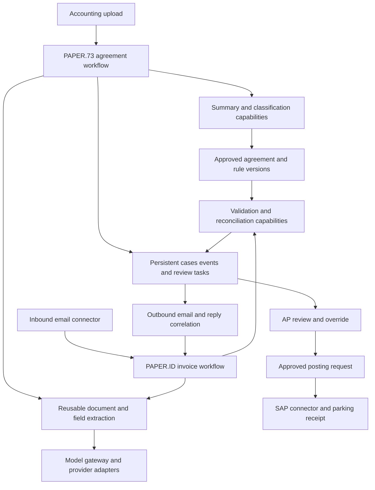

# PAPER workflow requirements and orchestration assessment

UniSensoryAI can supply reusable document extraction for PAPER.73 and PAPER.ID, but the current system does not implement their complete agreement-to-payment lifecycle. The PDF requires a business application around extraction: approved agreement master data, deterministic reconciliation, persistent approval and vendor-response states, and email/SAP integration. These can be added while preserving the existing document, chat, and policy workflows.

Implementation follow-up on 2026-10-14: external PAPER schemas, the approved agreement master, manual invoice reconciliation, and the web review workspace are now implemented. See [PAPER schemas and agreement master](PAPER_AGREEMENT_MASTER.md) and [PAPER UI testing](PAPER_UI_TESTING.md). The requirement tables below retain the 2026-10-13 assessment baseline; the following table records current progress.

The requirement source is *Target Solution Architecture & Workflow* (supplied PDF; not stored in this repository), pages 1–4. This assessment reflects the source reviewed on 2026-10-13. **Implemented primitive** means a reusable operation exists; **partial** means related infrastructure exists but the required business behavior needs work; **missing** means the domain operation or integration is not implemented. None of these labels establishes real-document extraction accuracy.

## Implemented follow-up

| Boundary | Current behavior and limit |
| --- | --- |
| External schemas and agreement master | Five schemas, tenant-scoped immutable versions, explicit approval/classification records, and approved effective-date lookup. Classification rule definitions and automated classification remain host responsibilities. |
| Manual package completeness | Typed document roles, source references, required fields/documents, extraction warnings, and configurable supporting types. Role selection is supplied by the caller; automatic classification, merged PDFs, and export naming remain future work. |
| Deterministic reconciliation | Identity, service-period coverage, currency, bank, source amount/tax arithmetic, and explicitly supported fixed-rent comparisons against approved terms. Revenue sharing and unsupported periods require review; calibrated confidence is not implemented. |
| Durable cases and duplicates | Tenant-scoped append-only packages/assessments and exact vendor/invoice duplicate claims with atomic storage guards. Fuzzy OCR, source-content duplicate detection, and external AP ledger checks remain separate extensions. |
| AP review and correction | Authorized approve/reject decisions with recorded reasons and permitted explicit overrides, bound to case/reference/policy versions. Corrected packages receive a new assessment; stale approvals are blocked. APIs, Swagger examples, and a dedicated web workspace support agreement and invoice review. Automatic rematch triggers remain future work. |
| Integration lifecycle | Mailbox delivery/replies, vendor communications, SAP parking, payment status, and recoverable external events are not implemented. |

Implementation verification: the initial implementation passed 182 PAPER tests and 204 existing workflow regression tests, including synthetic HTTP flows through actual rules and isolated SQLite storage. Local startup applied the PostgreSQL migrations and verified approval/reconciliation with the development reviewer. Web workspace verification subsequently passed 223 combined PAPER/API tests, 24 frontend tests, and a production build. Browser checks exercised draft/publication, matching/AP approval, missing-tax correction with retained history, explicit bank exception acceptance, duplicate blocking, JSON edit safety, and reload persistence against the local PostgreSQL backend. Model accuracy, email, and SAP validation remain separate work.

## PAPER.73 agreement setup

| Requirement and PDF page | Support at assessment baseline | Required addition at baseline |
| --- | --- | --- |
| Accounting uploads a rent agreement PDF, p1 | Implemented primitive: authenticated PDF upload/extraction. | PAPER.73 dashboard and a persistent agreement setup case linking the source, extraction, review, and master record. |
| AI OCR and document extraction, p1 | Implemented primitive: native text, optional OCR, multimodal page content, and source evidence. OCR requires a configured vision provider. | Configure the provider profiles and evaluate representative agreement scans. |
| Key contract terms extraction, p1–2 | Implemented primitive: fields can follow an external JSON Schema or Pydantic model. No PAPER agreement schema is supplied. | Define a versioned agreement schema for all master fields listed below. |
| Agreement summary generation, p1 | Missing as a dedicated PAPER operation. Model generation is available as a building block. | Add a summary capability that cites extracted terms and retains the full source separately. |
| PSAK 73 classification and non-PSAK 73 flag, p1 | Missing: no accounting classification engine or approved rule set. | Accounting-owned, versioned classification rules, recorded reasons/evidence, and review of uncertain or overridden decisions. |
| Exception and low-confidence flag, p1 | Partial: extraction produces warnings, source evidence, and `partial` status. | Business exception categories, review thresholds, and a validated confidence policy. Extraction status alone cannot establish accounting correctness. |
| Centralized agreement database and master rule base, p1–2 | Missing as an authoritative domain repository. Generic document storage exists. | Approved agreement versions, rule versions, effective dates, tenant scope, change history, and lookup by vendor/store/contract. |
| Agreement master becomes PAPER.ID reference data, p2 | Missing: no agreement publication or reconciliation lookup interface. | Publish an approved version; let invoice cases reference the exact agreement and rule versions used. |

The agreement schema must cover vendor/landlord, store ID/location, contract number, lease start/end dates, duration, payment schedule, fixed rent/revenue sharing, minimum guaranteed payment, renewal terms, PSAK 73 classification, and other key terms. Extracted terms should remain distinct from an approved classification: a model can propose data, while the classification service and reviewer establish the authoritative decision.

## PAPER.ID invoice processing

| Requirement and PDF page | Support at assessment baseline | Required addition at baseline |
| --- | --- | --- |
| Automatically fetch vendor email and attachments, p2 | Missing: authentication email is unrelated to mailbox ingestion. | Mailbox connector, message/thread identifiers, attachment storage, and case correlation. |
| Identify invoice, tax invoice, utility statement, and supporting documents, p2 | Partial: legacy ingestion uses extensions and filename keywords. | Content-based document-role classification, including uncertain or mixed-document cases. |
| Check completeness, p2 | Missing. | Required-document rules by invoice/category and a package completeness result. |
| Consolidate relevant attachments into one PDF/document package, p2 | Missing: reusable extraction accepts one PDF per call. | Package manifest and optional merged PDF export, preserving each original attachment and its page provenance. |
| Standardized naming `[VendorName]_[InvoiceNo]_[DocType]`, p2 | Missing as a business naming convention. Legacy upload uses UUID prefixes. | Configured export naming with sanitized values; retain stable internal source IDs. |
| OCR/data extraction for all listed document roles, p2 | Implemented PDF primitive; PAPER-specific schema bindings are missing. | Separate external schemas for rent invoices, tax invoices, utility statements, and supporting documents. Non-PDF email attachments need a conversion policy. |
| Validate vendor, store/location, invoice number, billing/service period, amounts/tax, bank account, p3 | Partial: schema validation can enforce data shape and host-supplied validators. No authoritative business validation service exists. | Master-data resolution and explicit business checks with field-level reasons and evidence. |
| Query PAPER.73 agreement master, p3 | Missing. | Approved agreement lookup using the relevant vendor/store/contract and effective period. |
| Cross-validate invoice, tax/supporting documents, and agreement/master, p3 | Missing. | A reconciliation service for identities, periods, amounts, taxes, bank details, and contract terms. Use deterministic comparisons and explicit tolerances supplied by the business. |
| Duplicate invoice detection, p3 | Partial: extraction creates a content hash identifier, but does not check duplicates. | Tenant-scoped source hashes and business duplicate keys, concurrency-safe storage, and a duplicate disposition. |
| Exception and confidence assessment, p3 | Partial: extraction warnings and evidence exist. | Aggregate business findings separately from extraction diagnostics; route missing, mismatched, uncertain, and technical-failure cases. |
| Valid/matched path to AP review and approval, p3 | Missing. Existing policy review is a separate text-analysis workflow. | AP work queue, review screen, approver permissions, approve/reject/override decisions, and an audit history. |
| AP reviews AI output and approves exceptions or overrides, p3 | Missing. A user role field does not establish an approval workflow. | Decisions tied to exact source, agreement, rule, and reconciliation versions, with actor, time, reason, and prior/new values. |
| Mismatch/incomplete path identifies missing or conflicting information, p3 | Missing as a business operation. | Structured exception results that identify each required correction or document. |
| Generate clarification and email vendor for missing documents/corrections/discrepancies, p3 | Missing. | Template-based or assisted message drafting, outbound email connector, and recorded send outcomes. |
| Continuous matching after new information, p2–3 | Missing: no persistent reply correlation or rematch trigger. The diagram does not explicitly draw the return loop. | Resume the same case when attachments or relevant approved agreements change, revalidate it, and invalidate any stale approval. |

The existing sample invoice schema illustrates schema-driven extraction, but does not contain the entire PAPER contract: store, service period, bank details, agreement reference, and document-package relationships must be specified by the consuming system. Source citations should use `(document_id, block_id)` across a package because page-local block IDs alone are not unique across attachments.

## SAP handoff and payment

| Requirement and PDF page | Support at assessment baseline | Required addition at baseline |
| --- | --- | --- |
| Route using the approved PSAK 73 classification, p4 | Missing. Generic router composition is available, without an approved accounting decision or posting state. | Deterministic route selection from the approved classification version. |
| PSAK 73 parking to `ZFI_CONTRACT_02`, p4 | Missing. | A SAP connector and validated contract-parking mapping agreed with the ERP team. |
| Non-PSAK 73 parking to `FV60 / Journal`, p4 | Missing. | A SAP connector and the agreed invoice/journal mapping. |
| Send agreement reference, classification, invoice/vendor metadata, store/cost object, amount/tax, supporting references, p4 | Missing as a SAP payload. | A typed posting request assembled from approved records, with a persisted receipt or error response. |
| Payment processing, p4 | Missing in UniSensoryAI; the PDF does not define execution responsibility or payment controls. | Define the boundary. A practical starting point is SAP-owned payment, with UniSensoryAI recording parking and downstream status. |

The transaction labels in the PDF do not specify callable interfaces. The SAP team must provide the supported integration transport and payload contract. Connector design must account for idempotency, uncertain submission outcomes, error recovery, and the distinction between parking and payment.

## What the current orchestration provides

The agent strategies provide sequencing, selection of one agent, and parallel fan-out within an active invocation. The document pipeline executes a YAML-defined stage list; the default background processor selects `basic`. Neither is a persistent business process with events, human tasks, approval waits, or checkpointed continuation.

The extraction service already provides a useful independent boundary: `extract_document` returns source content; `extract_fields` applies an external schema to that content; `extract` composes both. Providers, reader, and capabilities are injected. A PAPER host can embed these operations in Python or call the authenticated API without changing existing workflow definitions. Vision/OCR still requires a model with the appropriate capabilities; model independence does not make a text-only provider a vision provider.

Three implementation details affect the target design:

- **In-flight work is not recoverable through the current Redis queue alone.** `BLPOP` removes a job before execution, and the worker has no acknowledgement/reclaim mechanism. Existing retries repeat an entire document job; they do not protect email sending or SAP parking from repeated side effects.
- **Generic documents and ingestion statuses are insufficient as domain state.** The stored states are pending/processing/completed/failed, rather than awaiting vendor, awaiting AP, approved, or parked. The direct extraction API intentionally does not persist a job.
- **The policy reference loader must not become the agreement master unchanged.** Its query loads other text-bearing documents without tenant, approval, version, or effective-date filters. An authoritative agreement repository needs all of these constraints; the current missing tenant predicate is also a concrete isolation issue for that reference path.

The broader workflow runner and registry in the existing abstraction guide are explicitly proposed future work. The implemented PDF/schema boundary should not be mistaken for an implementation of that general runner.

## Recommended extension boundaries

Add a separate PAPER application composition root above the reusable extraction service. The business workflow can live in the consuming application or in a dedicated UniSensoryAI domain module. Keep its schemas, rules, repositories, and connector bindings local to those workflows so that a new capability or model profile does not change document/chat/policy entry points.

The main contracts should include `DocumentPackage`, `AgreementVersion`, `RuleSetVersion`, `ReconciliationResult`, `ReviewDecision`, `PostingRequest`, and `PostingReceipt`. Repositories should enforce business identity, uniqueness, approval history, and tenant scope. A schema version identifies the data contract; agreement, rule, and approval versions identify the business decision. They serve different purposes.

A persistent workflow layer should store case state and step outcomes, resume from correlated external events, and recover after worker crashes. Each short capability invocation can retain a bounded timeout while a case waits for days without holding a coroutine open. Recorded incoming events and pending outgoing actions allow retries without repeating already accepted email or SAP operations. Design the connectors to reconcile uncertain outcomes rather than assume that a timeout means nothing happened.

Proposed invoice states are `received → extracted → validated → reconciled → awaiting_ap → approved → parking_pending → parked`. Incomplete or mismatched cases enter `awaiting_vendor` and return to validation after a correlated reply. Extraction failures, rejection, duplicate disposition, and ERP errors require explicit outcomes. A changed source or decision version must invalidate an approval before another posting attempt.

## Example case through the proposed workflow

This is an illustrative future flow, with synthetic values and an accounting-approved classification supplied by the business:

1. PAPER.73 receives an agreement PDF for vendor `LANDLORD-17`, store `STORE-008`, and contract `RA-2026-042`. Extraction returns full content plus externally defined contract fields and citations. Review publishes approved agreement version `3`, including the business-approved classification and payment terms.
2. PAPER.ID receives invoice `INV-1042` for that vendor/store and service period. A package record links the email and invoice PDF. Its configured completeness rule also requires a tax invoice, which is absent.
3. Extraction returns invoice fields. Validation returns a `missing_tax_invoice` exception. The case enters `awaiting_vendor`; the email connector sends the recorded clarification request. Schema-valid extraction has not made the case matched or approved.
4. A reply supplies the tax invoice. Its message/attachment identifiers resolve to the same case. Extraction processes the new attachment, and reconciliation compares the package against agreement version `3`. AP reviews the resulting evidence and approves the exact case version.
5. The posting service selects the route from that approved classification and submits the validated payload. The case becomes `parked` only when the SAP receipt is recorded. Any subsequent payment occurs at the agreed downstream boundary.

## Implementation sequence and acceptance

1. **Establish agreement and case contracts.** Add PAPER schemas, tenant-scoped repositories, source/package identities, and persistent case transitions. Build PAPER.73 extraction, summary, accounting-rule classification, and review/publication of agreement versions. Acceptance: all required terms have values or explicit missing/uncertain findings, and only approved versions are available to reconciliation.
2. **Prove reconciliation using manually uploaded packages.** Add document roles, completeness, master lookup, deterministic matching, duplicate handling, and audited AP decisions. Acceptance: matched, mismatched, missing-document, duplicate, override, and stale-approval cases produce distinct durable outcomes.
3. **Automate external events and SAP handoff.** Add mailbox/outbound email adapters, reply/rematch events, and SAP mappings on the durable case layer. Acceptance: restart during processing, replayed messages, delayed replies, connector retries, and uncertain SAP outcomes do not lose a case or create duplicate effects.

This is a substantial business application extension. Extraction can be reused now; the difficult parts are authoritative business rules, durable state transitions, and external integration recovery. Evaluate model accuracy separately against representative rent, tax, and utility documents, including scans and tables. Mock-based interface tests cannot establish that accuracy or accounting validity.

The PDF leaves several contracts to define before integration: accounting rule ownership and thresholds, document requirements, vendor/store/bank authority, the exception-to-AP path, reply correlation and escalation, the treatment of agreement changes, supported SAP interfaces, and payment responsibility. In particular, its valid branch says AP can approve exceptions, while the mismatch branch goes to the vendor; the rule for bringing an unresolved exception to AP needs to be made explicit.

## Code evidence

| Source | What it establishes |
| --- | --- |
| [Extraction service](../src/extraction/service.py#L29) and [composition](../src/extraction/composition.py#L67) | Independent async extraction, external schemas, injected dependencies, and isolated extension points. |
| [Extraction options](../src/extraction/contracts/options.py#L13), [document capability](../src/extraction/capabilities/document.py#L50), and [field result](../src/extraction/contracts/field_result.py#L12) | Text/multimodal/OCR choices and evidence/warnings, without a calibrated reconciliation confidence score. |
| [Extraction endpoints](../src/api/extraction_routes.py#L216) | Authenticated one-PDF direct extraction without job persistence, plus field extraction from an existing result. |
| [Sequential strategy](../src/orchestration/strategies/pipeline.py#L35), [router](../src/orchestration/strategies/router.py#L31), [parallel strategy](../src/orchestration/strategies/parallel.py#L34), and [orchestrator](../src/orchestration/interfaces/orchestrator.py#L61) | In-process agent execution under a per-invocation timeout. |
| [Pipeline executor](../src/pipeline/executor.py#L127), [configuration](../configs/pipeline.yaml#L1), and [processor](../src/ingestion/processor.py#L99) | Ordered stage definitions and the default basic pipeline selection. |
| [Redis worker](../src/ingestion/redis_queue.py#L192) | Destructive dequeue before execution; document-job retries do not implement durable business waits or side-effect recovery. |
| [Document model](../src/db/models/document.py#L10) and [ingestion model](../src/db/models/ingestion.py#L11) | Generic document and job persistence, without the required agreement/invoice/approval/posting domain. |
| [Policy reference query](../src/policy/service.py#L109) and [review UI](../frontend/src/components/documents/InspectorPane.jsx#L308) | Existing review concerns policy text; reference selection lacks the constraints required for an agreement master. |
| [Invoice schema example](../examples/schemas/invoice_reconciliation.json#L9) and [abstraction guide](WORKFLOW_ABSTRACTION.md#L5) | A sample external schema and the explicit distinction between implemented extraction and a future general workflow runner. |

Original assessment scope on 2026-10-13: all four PDF pages were read and visually inspected; two focused source reviews covered orchestration and domain/integration support. That assessment changed no application code and executed no end-to-end PAPER workflow, live model, mailbox, or SAP test. Subsequent implementation and verification are recorded in the follow-up above.
