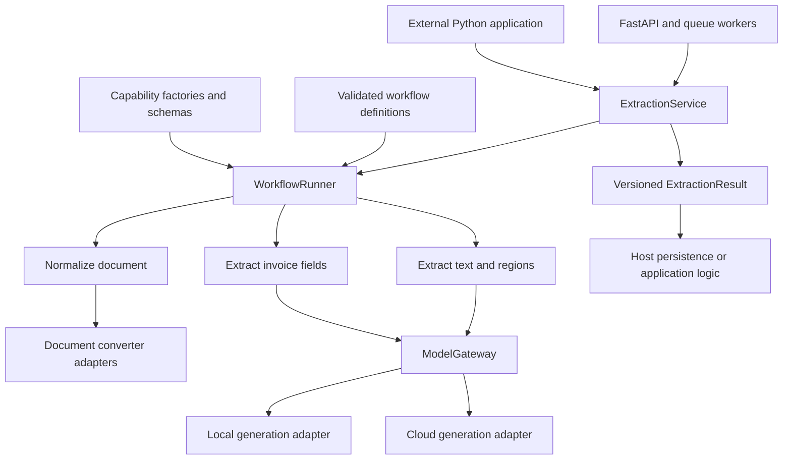

# Model agnostic workflows and capability extension

UniSensoryAI should expose document extraction as a reusable async service. A workflow defines the sequence of work; a capability implements one operation; a model adapter supplies inference; a typed artifact carries the result. These boundaries let an external application reuse extraction and let one workflow gain a new capability without changing other workflow definitions.

This is the broader proposed architecture. The reusable PDF and external-schema boundary is now implemented in `src/extraction/`; see [the implemented API and embedding guide](EXTRACTION_API.md). It is exposed through additive endpoints and does not replace existing job pipelines. The general workflow runner/registry below and migration of chat/policy remain future work.

## Dependency boundaries



The runner owns sequencing, branching, and failure decisions. Capabilities receive only their validated inputs and constructor dependencies. They return validated outputs and never invoke other capabilities or agents. File access, network calls, and persistence remain behind injected service or model ports.

The application composition root creates registries, adapters, gateways, and the service. Dependencies point toward contracts: reusable contracts and capabilities must not import FastAPI, queue implementations, SQLAlchemy sessions, application startup, or concrete provider SDKs.

The proposed module layout follows the existing source tree. Each directory below is relative to `C:/Users/HiDigi/OneDrive/Desktop/WebDev/UniSensoryAI` and may contain one public class per file.

| Proposed location | Contents |
| --- | --- |
| `src/core/contracts/` | Validated requests, results, content blocks, provenance, and artifact envelopes |
| `src/core/ports/` | Capability, generation, model gateway, converter, source reader, and artifact store ABCs |
| `src/capabilities/document/` | Normalization and extraction capabilities |
| `src/capabilities/invoice/` | Invoice field extraction and its input/output/settings schemas |
| `src/pipeline/` | Workflow definitions, bindings, factory registry, and runner; compatibility stage adapters during migration |
| `src/models/` | Concrete providers, profile resolver, gateway, and resource management |
| `src/services/extraction.py` | Database-independent public extraction facade |
| `src/extraction/composition.py` | Runtime construction and explicit plugin registration |

## Contracts

| Contract | Required responsibility |
| --- | --- |
| `ExtractionRequest` | Validated source, page or item selection, workflow ID and version, and permitted model profile overrides. Credentials are injected separately. |
| `DocumentSource` | Validated discriminated union of an in-memory binary document or an opaque source reference resolved by the host's source reader. Includes media type and source identity. |
| `NormalizedDocument` | Ordered text and image units with original page, sheet, slide, or paragraph identity. Images use binary asset references. |
| `BaseCapability[InputT, OutputT]` | One async operation with declared Pydantic input, output, and settings models. Constructor dependencies include only the services it uses. |
| `Artifact[PayloadT]` | Validated payload, schema ID and version, producing capability and version, and source provenance. |
| `WorkflowDefinition` | Ordered capability references, explicit input bindings, validated settings, required or optional steps, and output bindings. |
| `WorkflowRunner` | Compile and validate definitions, create capabilities through injected factories, bind and validate data, execute, and produce step records. |
| `BaseGenerationProvider` | Async model completion using typed text and image blocks and a normalized response. |
| `BaseModelGateway` | Resolve logical model profiles and enforce provider requirements, call budgets, caching, errors, and resource ownership. |
| `BaseAssetStore` | Async storage and resolution of generated binary assets, with explicit ownership and cleanup. |
| `ExtractionResult` | Versioned status, full extracted text, chunks, derived artifacts, warnings, sanitized errors, provenance, and execution records. |
| `ExtractionService` | Public async facade over the runner, without a database or queue dependency. |

The following signatures illustrate the two principal extension points. Referenced request, response, metadata, and descriptor types would be defined as validated contracts during implementation.

```python
from __future__ import annotations

from abc import ABC, abstractmethod
from typing import Generic, TypeVar

from pydantic import BaseModel

InputT = TypeVar("InputT", bound=BaseModel)
OutputT = TypeVar("OutputT", bound=BaseModel)


class BaseCapability(ABC, Generic[InputT, OutputT]):
    @abstractmethod
    async def run(self, data: InputT, metadata: RunMetadata) -> OutputT:
        """Execute one operation using injected dependencies."""
        ...


class BaseGenerationProvider(ABC):
    @property
    @abstractmethod
    def descriptor(self) -> ModelDescriptor:
        """Describe the configured model's supported features and limits."""
        ...

    @abstractmethod
    async def complete(self, request: ModelRequest) -> ModelResponse:
        """Generate a response from validated text and image blocks."""
        ...
```

Each public class belongs in its own implementation file. Capability registration supplies its input, output, and settings model classes together with a constructor factory. Run metadata carries request identity and execution deadlines; it contains no provider instances or credentials. The host establishes authorized scope and injects it into services rather than trusting a client-supplied tenant identifier.

Capabilities return new outputs instead of mutating shared inputs. Use immutable contract fields where practical and keep execution state in the runner, so later parallel branches cannot modify each other's data.

## Typed artifacts preserve extensibility

Example schema identities are `document.normalized@1`, `document.text@1`, `invoice.fields@1`, and `document.translation@1`. A schema registry maps each identity to its Pydantic model. Serialization may use JSON, but every payload is validated against its declared schema before storage or consumption. An unchecked dictionary of extension fields would recreate the current coupling problem.

A capability can publish a new registered artifact schema without adding another field to a shared pipeline context. Workflow bindings declare which earlier output supplies each input. Unknown schemas, undeclared outputs, duplicate step IDs, incompatible input bindings, missing prerequisites, and invalid settings fail definition compilation. Data-dependent limits are checked again when the actual request is available.

Provenance records source identity, original item number, item kind, and an optional bounding box or text span. Bounding boxes specify their coordinate system. Extracting PDF pages 10 through 12 must retain those page numbers; a spreadsheet uses sheet identity, and a presentation uses slide identity. Derived fields should cite the source units that support them. A model's unsupported claim is not evidence or calibrated confidence.

Full source extraction remains distinct from enrichment. Invoice fields, translations, summaries, and review findings add artifacts rather than replace extracted text. Native Office text passes through without loading a model. Vision inference is requested only for units that require it.

## Model requests and routing

`ModelRequest` contains typed messages and content blocks, generation settings, and an optional structured-output specification. Text-only requests are valid. An image block references a validated binary asset; provider-specific image encoding happens in the adapter.

`ModelResponse` contains normalized content, optional structured candidates, usage, finish reason, and resolved provider and model identity. Provider failures raise typed internal errors. A gateway or workflow boundary converts them into sanitized public diagnostics; it must never interpret an error response as empty successful text.

A workflow requests a logical profile such as `document_vision` or `structured_text`. Deployment configuration maps that profile to a concrete provider and model. Extraction and structuring may use different models.

Use dedicated profiles or pinned profile versions when a model change must affect only one workflow. Changing a shared profile changes every consumer of that profile; workflow isolation must make that dependency explicit.

Normalization and the gateway share an injected asset store or resolver. A small embedded run can use an in-memory implementation; large or durable runs use a host-provided store. Run-owned temporary assets remain available until all consumers, including timed-out local calls still executing, release them. Cleanup removes only run-owned assets; artifacts returned as durable references must first be promoted to host-owned storage. Source documents remain under their original owner's policy.

The model descriptor declares supported modalities, context and image limits, native structured-output support, and other implemented features. The resolver checks compatibility before a call. Model agnosticism means interchangeable implementations of a checked contract; accuracy and feature support still differ between models.

For structured output, configuration explicitly chooses native schema support or prompt-based JSON generation followed by parsing and Pydantic validation. A bounded repair attempt may be configured. Prompt-based generation must not be presented as guaranteed native schema enforcement. Fallback providers must be explicitly configured and satisfy the same task requirements.

Generation is the first model port. Embeddings, reranking, audio processing, and other task families receive separate ports when needed; providers should not implement irrelevant abstract methods.

The gateway owns operational concerns:

- Resolve credentials from injected configuration or an authorized credential service. Keep secrets out of requests, artifacts, persisted job metadata, and logs.
- Apply the configured outbound call rate limit to every provider call, including retries. Separate rate limits from concurrency limits.
- Enforce inference timeouts, bounded retries for transient failures, and normalized provider errors.
- Scope result caches by authorized tenant or host scope, resolved model revision and configuration, content digest, prompt version, schema version, and generation settings.
- Load local models lazily under an async lock and borrow them through leases. Eviction must not unload a model serving an active call.
- Use native async cloud clients. Run legacy synchronous local loading, inference, and unloading in bounded workers so the event loop remains responsive.

Cancelling an await around a worker thread does not stop its GPU computation. The resource lease and concurrency reservation must remain held until the actual operation ends. Hard cancellation requires an isolated process or worker service.

## Concrete invoice workflow

This illustrative configuration uses explicit bindings and three independently registered capabilities. The default basic workflow contains only normalization and extraction. Adding the invoice workflow does not modify that definition.

```yaml
model_profiles:
  invoice_vision:
    model_id: configured_vision_model
    requires: [text_input, image_input]
  invoice_fields:
    model_id: configured_text_model
    requires: [text_input]

workflows:
  invoice.extract@1:
    steps:
      - id: normalize
        uses: document.normalize@1
        inputs:
          source: "$request.source"
          selection: "$request.selection"
        required: true

      - id: extract
        uses: document.extract_text@1
        inputs:
          document: "$steps.normalize.document"
        settings:
          vision_profile: invoice_vision
        required: true

      - id: invoice
        uses: invoice.extract_fields@1
        inputs:
          text: "$steps.extract.text"
          chunks: "$steps.extract.chunks"
        settings:
          model_profile: invoice_fields
          schema_id: invoice.fields@1
          output_strategy: prompted_json
        required: false

    outputs:
      text: "$steps.extract.text"
      chunks: "$steps.extract.chunks"
      artifacts:
        - binding: "$steps.invoice.fields"
          optional: true
```

The three steps connect through these contracts:

| Step | Example input | Example output |
| --- | --- | --- |
| Normalize | A two-page PDF and requested pages 1 through 2 | Ordered native text units and image references, with original page identities |
| Extract | Normalized units | Full text, source chunks, and provenance; image units use the vision profile |
| Invoice fields | Extracted text, source chunks, and invoice schema | Validated invoice fields with references to source chunks |

The invoice step is optional in this example so extracted text remains available if enrichment fails. A caller that requires valid invoice fields should use a definition where that step is required.

An example result is below. Omitted run IDs, usage, and execution records are still part of the full contract. The final invoice schema must define monetary precision, missing-value behavior, and field-level provenance.

```json
{
  "schema_version": "1",
  "workflow": "invoice.extract@1",
  "status": "succeeded",
  "text": "Invoice INV-1042\nTotal USD 120.00",
  "chunks": [
    {"id": "chunk-1", "page": 1, "type": "text", "content": "Invoice INV-1042\nTotal USD 120.00"}
  ],
  "artifacts": [
    {
      "id": "artifact-1",
      "schema_id": "invoice.fields@1",
      "producer": "invoice.extract_fields@1",
      "payload": {"invoice_number": "INV-1042", "total": "120.00", "currency": "USD"},
      "provenance": {"source_chunk_ids": ["chunk-1"]}
    }
  ],
  "warnings": [],
  "errors": []
}
```

Changing the vision profile's configured model changes provider selection without editing the capabilities. Adding translation means registering `document.translate@1` and its schema, then adding it to a separately versioned workflow.

## External embedding

An external Python host uses the same service as the queue worker. It supplies a source reader, gateway, registries, and shared asset store through a composition function. Durable artifact storage is optional for results returned inline. The host gateway resolves generated images through the same asset store passed to the service. The following is a proposed usage example, not an existing SDK API.

```python
service = build_extraction_service(
    config=validated_config,
    model_gateway=host_model_gateway,
    source_reader=host_source_reader,
    capability_registry=host_capabilities,
    asset_store=host_asset_store,
    artifact_store=host_artifact_store,
)

result = await service.extract(
    ExtractionRequest(
        source=SourceReference(source_id="invoice-1042", media_type="application/pdf"),
        workflow="invoice.extract@1",
    )
)
```

The host decides whether to persist the result, return it directly, or pass an artifact to another system. A source reader supports only the source types and locations authorized by that host; a source reference does not imply unrestricted URL fetching or filesystem access. Source size, media type, path safety, and temporary-file cleanup apply to embedded use as well as HTTP uploads.

FastAPI authentication and tenant checks remain at the hosted boundary. Queue workers map validated requests to the service and persist results through database services. Database writes and successful job completion belong in the same transaction. The extraction package itself does not create jobs or connect to PostgreSQL or Redis.

To ship this as a lightweight reusable package, its public import path must avoid application startup and eager heavy model imports. Move hosted API, database, and queue dependencies into a server extra or a separate distribution when shipping the embedded package; the current package declares them as core dependencies. Keep local ML dependencies optional and reconcile package metadata with the lockfile before advertising installable SDK support.

## Extension procedure

| Extension | Files or configuration to add | Existing workflow impact |
| --- | --- | --- |
| New capability | Pydantic input/output/settings schemas, capability implementation, tests, factory registration, and an opt-in workflow step | Existing versioned definitions remain unchanged |
| New generation provider | Adapter, descriptor/configuration, provider contract tests, and composition registration | Compatible profiles can select it without capability edits |
| New document format | Converter adapter producing normalized units, safety rules, tests, and converter registry registration | Extraction consumes the same normalized contract |
| New output schema | Pydantic payload model and schema registration | Workflows explicitly request that schema version |
| New model task family | A dedicated model port and consuming capability | Existing generation adapters gain no unrelated obligations |

Start with explicit plugin registration at application construction. Automatic package discovery is unnecessary until capabilities are distributed as separate packages. Registries belong to each runtime container; tests and external hosts must not depend on global mutable registration state.

Pin workflow, capability, schema, and prompt versions. Breaking changes receive new versions. A new plugin cannot alter an existing workflow merely by being installed. Shared resource contention still requires concurrency quotas and, when needed, separate worker pools or processes; code modularity alone does not provide runtime isolation.

## Failure and timeout semantics

Required-step failure returns `failed` with a sanitized typed error. The host marks the job failed and does not save an empty document as successful. Optional enrichment failure retains source extraction and returns `partial` with a warning. Dependent steps with missing prerequisites must have an explicit skip or fail policy; optionality alone must not silently hide missing data.

Existing database job statuses can remain intact initially: a partial extraction can map to `COMPLETED` while preserving the result's `partial` status and warnings in its serialized payload. Adding a database status requires a separate migration. A consumer can distinguish succeeded, partial, failed, and cancelled results without inspecting arbitrary dictionary keys.

An explicit workflow cancellation can return a typed cancelled outcome. Task shutdown or parent cancellation instead records available execution state, performs bounded cleanup, and propagates `asyncio.CancelledError`. It must not be swallowed as a normal result or retried as a provider failure. The host owns durable cancellation recording and its mapping to existing job states.

Use operation-specific budgets: agents up to 30 seconds, tools up to 15 seconds, and model inference up to 60 seconds, as required by repository policy. A document workflow can contain multiple bounded operations under an explicit total deadline. Treat a capability as its actual operation category rather than forcing all work under one generic timeout. The current advanced pipeline's blanket 90-second stage timeout should not become the new default.

## Incremental implementation

The current extraction seams support a gradual migration:

| Current seam | Target change |
| --- | --- |
| [Core model API](C:/Users/HiDigi/OneDrive/Desktop/WebDev/UniSensoryAI/src/core/base.py): synchronous image-plus-prompt calls | Legacy adapter behind the async generation port; text-only inputs become valid |
| [Pipeline context](C:/Users/HiDigi/OneDrive/Desktop/WebDev/UniSensoryAI/src/pipeline/context.py): live model object and loosely typed content | Typed serializable inputs and outputs; dependencies stay in constructors |
| [Pipeline executor](C:/Users/HiDigi/OneDrive/Desktop/WebDev/UniSensoryAI/src/pipeline/executor.py): global class registry and name-only construction | Inject factories and validate explicit bindings and outputs |
| [Pipeline output merge](C:/Users/HiDigi/OneDrive/Desktop/WebDev/UniSensoryAI/src/pipeline/executor.py): drops unknown output keys | Registered artifact schemas and explicit workflow outputs |
| [Inference stage](C:/Users/HiDigi/OneDrive/Desktop/WebDev/UniSensoryAI/src/pipeline/stages/inference_stage.py): imports loader from ingestion | Inject a gateway and avoid model loading for native text |
| [Structured output stage](C:/Users/HiDigi/OneDrive/Desktop/WebDev/UniSensoryAI/src/pipeline/stages/structured_output_stage.py): blank image for a text task | Genuine text-only generation with an explicit output strategy |
| [Processor](C:/Users/HiDigi/OneDrive/Desktop/WebDev/UniSensoryAI/src/ingestion/processor.py): hardcoded basic selection and mixed error forms | Thin compatibility adapter over validated service requests and results |
| Memory and Redis workers: complete any returned result | Consume the same typed success, partial, and failure contract |
| [Document persistence](C:/Users/HiDigi/OneDrive/Desktop/WebDev/UniSensoryAI/src/services/document.py): saves text and chunks only | Persist a compatible result representation including derived artifacts and diagnostics |

Implement in these increments, writing failing tests before the corresponding runtime changes:

1. Define request, result, provider, and capability contracts. Add fake-provider and failure-contract tests, then implement legacy adapters and an extraction composition root.
2. Expose `ExtractionService` over the existing extraction stages. Inject factories and gateway dependencies. Retain `basic` as the default and preserve the legacy `content`, `page_count`, and `chunks` serialization.
3. Introduce explicit artifact schemas and bindings as stages migrate individually. Add a versioned invoice workflow with its own model profile. Persist derived artifacts, partial status, and diagnostics before exposing that workflow through the API; validate selection through both queue implementations.
4. Complete packaging compatibility, then demonstrate extraction from an external Python host without FastAPI, PostgreSQL, Redis, or installed local ML dependencies.

Keep the initial runner sequential. Introduce parallel branches, durable workflow resumption, or a general graph engine only when a concrete workflow requires them. Reuse adapters for the existing async chat provider later; extraction migration should not require simultaneous chat or policy changes.

Acceptance checks establish the boundary:

- Existing basic extraction preserves full native text, item order, original page selections, and legacy response fields.
- Native-text extraction makes zero model calls and works without local ML imports.
- Two compatible fake generation providers run the same workflow with identical validated result shapes.
- Unsupported model features, bad capability settings, and invalid artifact bindings fail explicitly.
- A new capability publishes a validated artifact without editing the runner or a shared context class.
- Required failures mark jobs failed in both workers; optional failures preserve text and persist diagnostics.
- Provider timeout and cancellation retain correct resource ownership; secrets and provider objects never serialize.
- Hosted authorization and tenant boundaries remain effective, including result caching and persistence.
- Chat and policy behavior passes its existing regression checks.
- An external host imports and invokes extraction through the public facade with injected dependencies.

The first deliverable is a small reusable extraction boundary with explicit contracts and adapters. Its quality should be judged by these extension and compatibility checks before expanding the orchestration framework.
